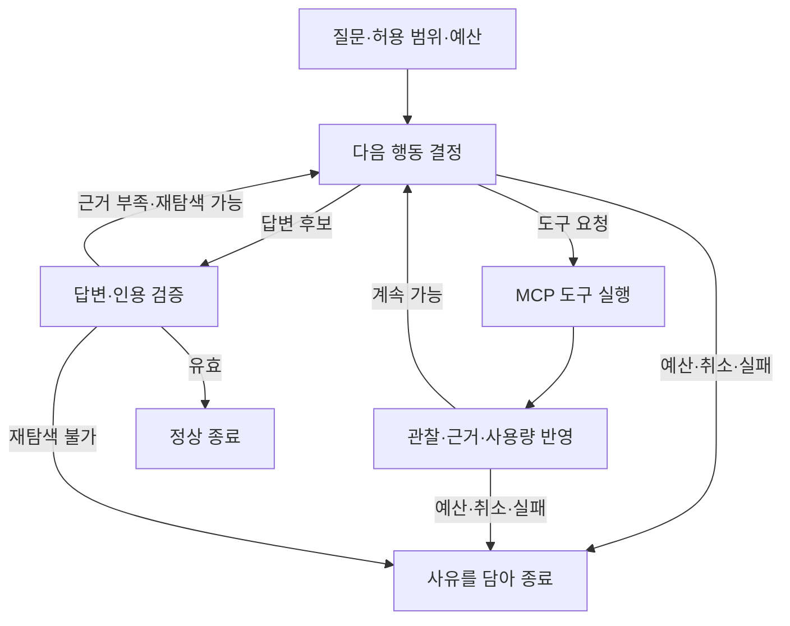

# 4. 상태·분기·종료·재개를 직접 구현하기

[전체 진행표](README.md) · 이전: [LangChain](03-langchain-models-and-tools.md) · 다음: [웹](05-web-agent-mode.md)

목표는 “왜 while 루프 대신 그래프인가?”를 상태 전이와 실패 복구 사례로 설명하는 것이다. 먼저 정해진 모델 응답으로 검증하고, 실제 모델 연결은 그다음에 확인한다.

## 먼저 그릴 상태 전이

모든 질문에 별도의 분해 모델 호출을 강제하지 않는다. 빈 검색 결과, 잘못된 인용, 도구 실패를 무제한 반복으로 해결하지 않는다.

## 읽을 코드

- [agent/types.py](../app/agent/types.py), [agent/loop.py](../app/agent/loop.py): 기존 예산·종료·관찰·인용 규칙
- [contracts/evidence.py](../app/contracts/evidence.py): 공통 출처 계약
- [workflow/runner.py](../app/workflow/runner.py), [observability/budget.py](../app/observability/budget.py): 기존 workflow의 예산 의미
- [test_loop.py](../tests/agent/test_loop.py): 유지할 행동 요구

공유할 인용·예산 규칙만 책임에 맞는 위치로 추출한다. 기존 루프는 비교 평가 대상이므로 유지하며, 새 그래프가 그 루프를 한 노드로 감싸는 데 그치지 않도록 한다.

## 직접 할 일

1. 상태 필드를 선언한다: 질문, 고정된 검색 범위, 메시지, 확보한 근거, 호출 결과, 누적 사용량, 종료 사유. 각 필드를 누가 갱신하는지 적는다.
2. 먼저 모델·DB 없는 결정적 응답으로 정상 종료와 `NOT_IN_DOCS` 두 경로를 만든다.
3. 2~3단계의 실제 MCP 실행을 도구 노드에 연결한다. 결과의 원문 식별자를 관찰 상태에 보존한다.
4. 답변 검증 실패 후 한 번 재탐색하는 사례와 예산 때문에 재탐색하지 못하는 사례를 만든다.
5. 각 외부 호출 직전에 예산·취소를 검사한다. 누적 token, cost, iteration, elapsed time은 단위와 소유자가 다르다.
6. 별도 SQLite 파일의 checkpointer를 연결한다. 공시 DB schema에는 손대지 않는다.
7. 새 그래프를 실행·조회·명시적으로 재개할 CLI 진입을 구현한다. 실제 정한 옵션을 도움말과 테스트에 반영한다. 기존 루프 실행도 계속 선택할 수 있어야 한다.

필드 수를 늘리는 것보다 상태의 소유권과 종료 불변식을 먼저 정한다. 같은 근거·사용량을 여러 노드가 중복 누적하지 않도록 한다.

## 체크포인트 실습

[`Persistence`](https://docs.langchain.com/oss/python/langgraph/persistence)와 [`Checkpointers`](https://docs.langchain.com/oss/python/langgraph/checkpointers)를 읽는다. 설치한 SQLite 구현의 연결 수명과 async 사용법을 확인한다.

1. 실행 ID를 고정하고 MCP 관찰을 저장한 뒤, 다음 모델 호출 전에 명시적으로 멈춘다.
2. 프로세스를 재시작한다. 저장된 상태를 조회하되 자동 실행하지 않는다.
3. 사용자가 재개를 요청하면 같은 실행 ID와 저장 상태로 진행한다.
4. 다른 실행 ID가 이전 사용자의 메시지·근거를 읽지 않는지 검증한다.
5. 모델 요청을 보냈지만 응답 저장 여부가 불명확한 중단을 재현한다. 이 상태에서는 자동 재호출하지 않는다.

체크포인트는 외부 API의 정확히 한 번 실행이나 과금 취소를 보장하지 않는다. SQLite 파일에는 질문·메시지가 저장될 수 있으므로 자격증명을 상태에 넣지 않고 실행 데이터 파일을 Git에 커밋하지 않는다.

## 검증할 상태 전이

| 시나리오 | 관찰할 결과 |
|---|---|
| 정상 근거·유효 인용 | 답변과 출처를 담아 종료 |
| 검색 결과 없음 | `NOT_IN_DOCS` 또는 명시된 제한 사유 |
| 가짜 인용·변조된 원문 해시 | 정상 답변으로 종료하지 않음 |
| 도구 실패 | 실패 관찰과 제한된 후속 행동 |
| 예산 소진 | 추가 모델·검색 호출 없음 |
| 취소·연결 해제 | 이후 새 외부 호출 없음, 자원 정리 |
| 재시작·명시적 재개 | 저장된 상태에서 이어짐 |
| 유료 호출 결과 불명 | 자동 재실행 없음 |

## 통과 기준

- [ ] 각 노드의 입력·상태 갱신·다음 분기를 설명한다.
- [ ] 위 시나리오를 실제 그래프를 실행하는 테스트로 확인한다.
- [ ] 체크포인트 재개와 모델 요청 재시도를 구분한다.
- [ ] 원래 루프보다 좋아진 점과 추가 복잡성을 구체적으로 말한다.
- [ ] 실제 모델 검증과 결정적 응답 검증을 별도로 표시한다.
