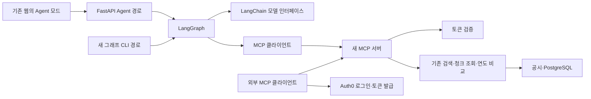

# Workflow B — 직접 구현하는 MCP·LangGraph 학습 가이드

목표는 **직접 만든 MCP 서버를 연결·운영하고, LangGraph를 선택한 이유와 평가 결과를 설명하는 것**이다. 동작하는 데모와 직접 수정·진단할 수 있는 이해도를 함께 만든다.

이 디렉토리는 첨부한 Workflow B 계획을 현재 코드에 연결한 한국어 실습 안내다. 제품 구현은 `app/`, `web/`, `tests/`에 두고, 여기에 별도의 데모 애플리케이션을 복제하지 않는다. 코드·주석·제품 유지관리 문서는 기존 영어 관례를 따른다. OPS 설정이나 전달 절차를 학습의 선행 과제로 삼지 않는다.

## 시작 방법

1. [0단계](00-understand-current-flow.md)의 첫 과제를 한다. 오늘은 필요한 코드만 읽는다.
2. 설명 → 결과 예측 → 직접 구현 → 실패 재현 → 설명과 리뷰 순서로 한 과제씩 진행한다.
3. 막히면 힌트 → 작은 예제 → 해당 부분 공동 구현 순서로 도움을 받는다.
4. 각 단계의 통과 기준을 확인한 뒤 아래 진행표를 갱신한다. 테스트 통과만으로 학습 통과를 표시하지 않는다.

학습 코치와 시작할 때 사용할 문장:

> `study/README.md`와 이번 단계 가이드를 읽고 학습을 도와줘. 한 번에 한 과제를 내고, 먼저 내 설명이나 실행 결과 예측을 확인해줘. 내가 구현할 부분의 완성 코드는 먼저 주지 말고, 막히면 힌트부터 줘. 검증 결과와 내가 이해한 내용을 구분해서 다음 단계로 넘어가자.

## 진행표

`미시작`, `진행 중`, `통과`, `막힘`을 사용한다. 근거에는 실행한 명령·관찰한 결과·설명하지 못한 점을 짧게 적는다. 아래 초기 상태는 가이드 작성 완료가 제품 구현 완료를 뜻하지 않음을 보여준다.

| 단계 | 핵심 결과 | 학습 | 구현 | 검증 | 근거 / 다음 과제 |
|---|---|---|---|---|---|
| [0. 현재 구조](00-understand-current-flow.md) | 웹·CLI·MCP 경로를 구분한다 | 미시작 | 해당 없음 | 미시작 | 질문 하나의 경로 그리기 |
| [1. 작은 MCP 서버](01-small-mcp-server.md) | 모델 없이 도구를 발견·호출한다 | 미시작 | 미시작 | 미시작 | SDK와 transport 경계 |
| [2. 실제 도구](02-filing-tools-and-transports.md) | 공시 도구 3개를 stdio·HTTP로 호출한다 | 미시작 | 미시작 | 미시작 | 출처와 검색 범위 보존 |
| [3. LangChain](03-langchain-models-and-tools.md) | 모델 요청과 도구 실행 결과를 연결한다 | 미시작 | 미시작 | 미시작 | 메시지·구조화 출력·사용량 |
| [4. LangGraph](04-langgraph-state-and-resume.md) | 반복·검증·종료·명시적 재개를 구현한다 | 미시작 | 미시작 | 미시작 | 먼저 결정적 모델로 상태 전이 |
| [5. 웹](05-web-agent-mode.md) | Agent 모드로 실제 실행과 취소를 보여준다 | 미시작 | 미시작 | 미시작 | 기본 리뷰 보존 |
| [6. OAuth](06-auth0-and-external-mcp.md) | 외부 클라이언트 접근 권한을 검증한다 | 미시작 | 미시작 | 미시작 | Auth0·HTTPS·프록시 |
| [7. 평가·면접](07-evaluation-ci-and-interview.md) | 비교 결과·CI·영어 설명을 완성한다 | 미시작 | 미시작 | 미시작 | 성능이 나빠진 사례도 분석 |

원 계획의 2026-09-27 파리 시간 21시는 진행 상황을 확인하는 시각이다. 0~4단계를 우선하고 가능하면 웹 첫 답변까지 연결하되, 이해도 확인을 생략하지 않는다. 이후에는 하루 2~3시간씩 남은 과제를 이어간다. 전체 완료는 단계별 수용 기준으로 판단한다.

## 현재 출발점

2026-09-27, `mcp-and-langgraph` 브랜치에서 기존 구조를 확인한 뒤 사용자의 요청으로 기존 MCP를 제거했다. 제거 전 기준 커밋은 `54b79693`이다. 이후 코드가 바뀌면 이 표를 영구적인 현재 상태로 취급하지 않는다.

| 항목 | 확인한 상태 | 의미 |
|---|---|---|
| Python | 로컬 `.venv`: 3.14.1 | 계획의 기본 환경과 일치 |
| MCP 서버·테스트 | 기존 파일·CLI `--mcp`·전용 schema 변환 제거 | 1단계에서 빈 파일부터 직접 작성 |
| MCP 의존성 | `pyproject.toml`·`uv.lock`에서 제거 | 1단계에서 SDK 2.1.1을 다시 추가 |
| CLI | `python -m app.agent`, 기존 `run_agent` | 비교 평가에 쓸 기존 루프 유지 |
| 웹 | `/review`, `/review/stream` → 기존 workflow | 기본 경로 유지, Agent 경로 추가 |
| LangChain / LangGraph | 로컬 환경에 미설치, 직접 의존성에도 없음 | 3~4단계에서 추가·통합 검증 |
| 기존 평가 | 검색 결과의 Recall@k, Hit Rate@k, MRR 등 | 답변 정확성 평가는 별도로 구현 |

계획에 제시된 MCP 2.1.1·LangChain 1.4.2·LangGraph 1.2.12는 **새 구현의 목표 버전**이다. 계획에 적힌 의존성 해결 성공과 이 브랜치의 실제 통합 성공을 구분한다. MCP extra, 모델 통합 패키지, SQLite checkpointer까지 포함한 잠금 결과를 확인한다. 기존 `.venv`는 이 제거 작업에서 동기화하지 않았으므로 MCP 패키지가 남아 있을 수 있다. 설치 흔적과 이 브랜치의 구현·의존성 선언은 다르다.

공식 문서도 버전이 바뀐다. 현재 공식 서버 진입점은 [`MCPServer`](https://py.sdk.modelcontextprotocol.io/), LangChain 연결은 [`langchain.mcp.MCPAdapter`](https://docs.langchain.com/oss/python/langchain/mcp)다. 후자는 `langchain[mcp]>=1.4.0`의 베타 인터페이스다. 실제 설치 버전과 맞춰 읽고, 예전 `langchain-mcp-adapters` 예제를 섞지 않는다.

## 완성할 연결



그림의 새 경로는 목표 구조다. 현재 이미 연결되어 있다는 뜻이 아니다. MCP는 도구 호출 규약, LangChain은 모델·메시지·도구 인터페이스, LangGraph는 상태 전이와 종료 조건을 맡는다. 모델은 다음 행동을 제안하고 프로그램이 권한·입력·예산을 검증하여 실행한다.

## 계속 지킬 경계

- `search_filings`, `fetch_chunk`, `compare_years` 이름과 기존 검색·출처 식별자를 유지한다. 기존 MCP 구현은 이미 제거했으며 복사본이나 병행 구현을 만들지 않는다.
- 기존 에이전트 루프와 도메인 도구는 평가·재사용 대상이므로 유지한다. MCP 제거와 기존 루프 삭제는 다른 작업이다.
- 요청한 검색 범위가 도구 호출에서 넓어지지 않아야 한다. 오류와 정상적인 검색 결과 없음은 구분한다.
- 기본 웹 리뷰와 과거 이력서는 보존한다. 새 경로는 `/agent/review`, `/agent/review/stream`으로 분리한다.
- 체크포인트는 별도 SQLite 파일에 저장한다. 공시 DB 스키마는 바꾸지 않고, 중단된 실행은 자동 재개하지 않는다.
- 실제 학습·사전 평가·본평가·재검증의 유료 호출 총액은 **25 USD 이내**다. 검색 임베딩·번역 등 부수 호출도 포함한다. 금액 불명의 진행 중 요청은 소진 가능액으로 잡고 자동 재호출하지 않는다.
- 문서의 실행 예시는 유료 호출·외부 설정·게시·배포를 지금 승인하거나 실행했다는 뜻이 아니다. 해당 단계에서 구체적인 변경과 비용을 확인한다.

## 명령을 읽는 방법

명령은 저장소 루트에서 실행한다. 현재 `.venv`의 실행 파일을 사용하면 학습 확인 중 의존성이 자동 갱신되지 않는다. 환경이 없으면 기존 [DEV 가이드](../docs/TUTORIAL/ko/quickstart-dev.md)를 먼저 읽고 필요한 준비를 구분한다.

```bash
git status --short --branch
.venv/bin/python --version
.venv/bin/python -m app.agent --help
```

위 도움말 명령은 가이드 작성 때 실행했다. 뒤의 각 단계에 있는 테스트 명령은 **학습자가 해당 단계에서 실행할 절차**이며, 가이드 작성 과정에서 통과시킨 결과가 아니다. DB 통합에는 명시적인 폐기용 `DOCREVIEW_TEST_DATABASE_URL`을 사용한다. 브랜치 변경은 실행 중 서비스나 DB를 분리하지 않는다.

다음 행동: [0단계의 첫 과제](00-understand-current-flow.md#첫-과제)에서 시작한다.
